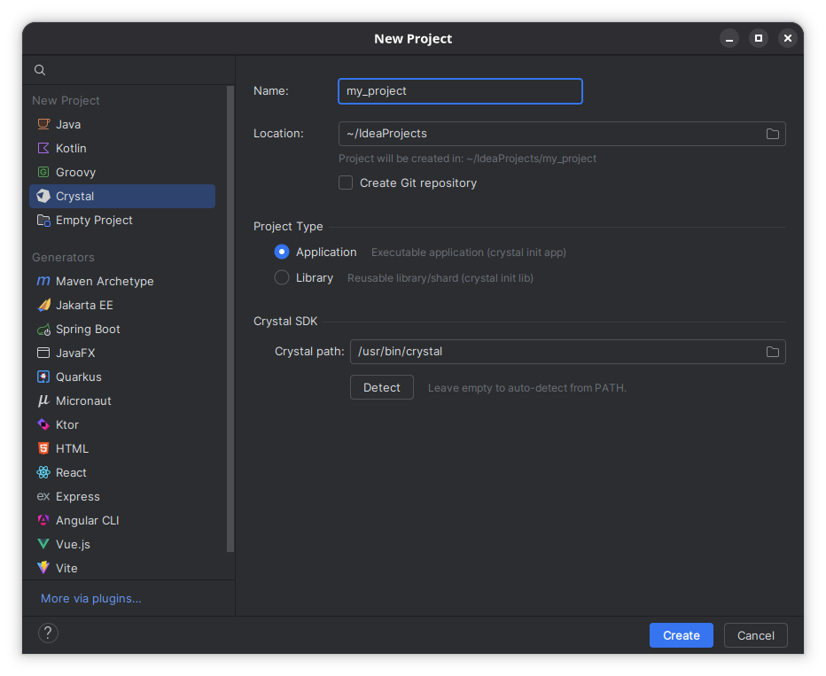
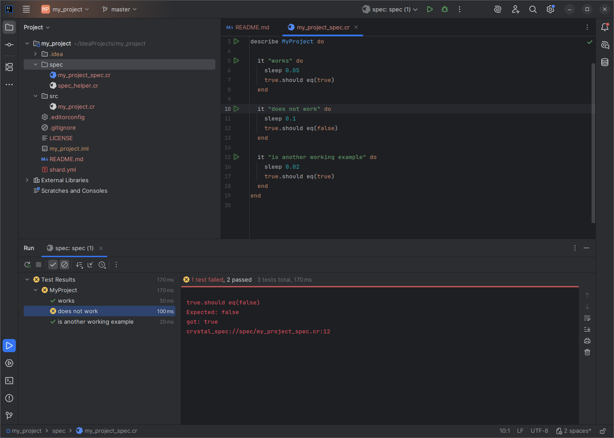
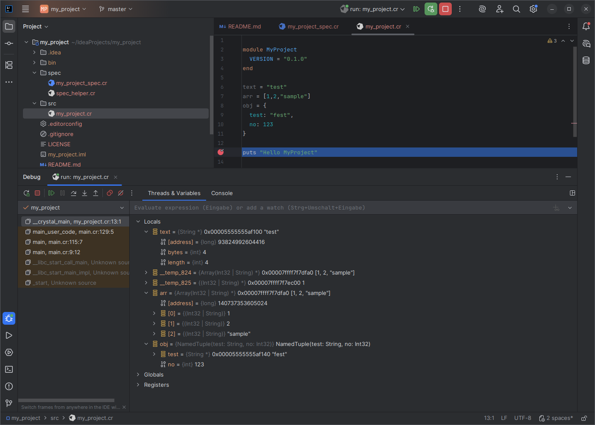

<p align="center">
  
</p>

# Fast Crystal

Crystal language support for JetBrains IDEs — IntelliJ IDEA, RubyMine, WebStorm, and anything else on the 2026.1+ platform.

It gives Crystal the things an IDE is expected to know about a language: what a name refers to, what type it has, which arguments a method takes, and how to build, run, and debug the result. Parsing is GrammarKit PEG; every cross-file lookup goes through StubIndex rather than scanning the project.

**Status:** the whole Crystal standard library (2172 files) parses with 2 residual errors, both pre-existing EOF artifacts, and 94% of its references resolve. The plugin is verified against IntelliJ IDEA Ultimate and RubyMine 2026.1 and 2026.2; 2026.3 runs but is not in the verification matrix yet.

## Why it is fast

The plugin started as a rewrite of an unmaintained one that could not edit real Crystal files. The numbers that motivated it, measured on the [catalyst](https://github.com/unurgunite/catalyst) project:

| Metric | Before | After |
|---|---|---|
| Parse time, 2.5 KB file (`src/catalyst/formatters/json.cr`) | 191 s | 94 ms |
| Project index, 522 `.cr` files | 709 s, stuck at 95–99% | completes, IDE goes idle |
| Parse errors in `float.cr` (Crystal 1.21 stdlib) | present | 0 |
| `StackOverflowError` on self-referential assignments | crash | unknown type, no crash |

The whole stdlib is parsed and resolved by the plugin's own code in CI (`stdlibParseErrors`, `stdlibStructure`, `stdlibBuildGraph`, `stdlibCheckFile`), so a grammar regression shows up as a number before it ships.


*New project wizard.*


*Spec runner with gutter icons and result tree.*


*Debugging via lldb-dap: breakpoints, variables, stepping.*

## What it does

**Navigation.** Go to Definition on types, methods, macros, `@`/`@@` variables, `obj.method` / `Class.method` calls, and namespace segments (`Inner` in `Outer::Inner.method`). Also Go to Symbol, Go to Class, Find Usages, Structure View, and Quick Documentation — doc comments rendered as Markdown, with type names linking to their own documentation. Hovering a variable shows its inferred type.

**Completion.** Class methods after `Class.`, instance methods after a variable once its type is inferred, locals/params/class variables in free text, types after `:` in annotations and inside `Array(` or `String | `. Overloads appear as separate entries with their signatures. `record` definitions get completion, parameter info, and argument checks instead of being treated as plain calls.

**Inspections.** Eight of them, following Crystal's actual rules: argument types against parameter annotations (numeric autocasting, unions, nilable types, overloads — an error only when every overload rejects), argument counts (named args, splat, double-splat, defaults), assigned-but-never-read variables, empty collection literals, untyped `lib fun` parameters, colon spacing, instance variable types, and single-quote strings.

**Editing.** Syntax and semantic highlighting, keyword-block highlighting that shows you the `def`/`end` pair you are inside, folding, brace matching, auto-inserted `end`, and `crystal tool format` behind Reformat Code.

**Refactoring.** Rename (Shift+F6) with preview, identifier validation, and a `crystal build --no-codegen` check that runs after the rename and reports compile errors in a notification. Implement Members (Ctrl+I) discovers abstract methods in parents and writes the stubs.

**Run & Debug.** `crystal run`, `build`, and `spec` configurations with arguments, environment, and working directory. The spec runner has gutter icons, single-test execution, and a result tree with click-to-source. The debugger speaks DAP over `lldb-dap`: breakpoints, stepping, variable inspection, and the Crystal value formatters bundled from the compiler repo.

**Also.** 21 live templates (`def`, `deft`, `class`, `classi`, `mod`, `struct`, `enum`, `if`, `ife`, `unless`, `while`, `each`, `map`, `begin`, `case`, `describe`, `it`, `prop`, `getter`, `init`, `req`), TODO indexing, customizable colors, and `asm(...)` section-by-section parameter info.

## Requirements

- **IntelliJ Platform 2026.1+** — IntelliJ IDEA Ultimate, RubyMine, WebStorm, or any IDE on that platform
- **Crystal** on your `PATH` — needed for formatting, running, and the post-rename compile check. Everything else works without it
- **`lldb-dap`** — only for the debugger. It is **not** looked up on `PATH`; see below

## Installing

The plugin is not on JetBrains Marketplace yet. Build it and install the ZIP from disk:

```bash
git clone https://github.com/unurgunite/fast-intellij-crystal.git
cd fast-intellij-crystal
./gradlew buildPlugin
```

`build/distributions/` will contain the installable ZIP — *Settings → Plugins → Install Plugin from Disk*. Use `./gradlew runIde` if you would rather launch a throwaway IDE with the plugin loaded.

### The debugger's `lldb-dap`

`crystal` is found through `PATH`. `lldb-dap` is **not** — the plugin tries a fixed list and gives up if none of it is executable, so a working `lldb-dap` on `PATH` is still invisible to it:

| Platform | Directories checked |
|---|---|
| macOS, Linux | `/usr/bin`, `/usr/local/bin` |
| Windows | `C:\Program Files\LLVM\bin`, `C:\Program Files (x86)\LLVM\bin` |

The legacy `lldb-vscode` name is accepted too. If your package manager installed the binary somewhere else, symlink it.

**Arch / Manjaro / EndeavourOS / CachyOS**

```bash
sudo pacman -S crystal shards lldb   # lldb ships lldb-dap
```

**Debian / Ubuntu / Mint / Pop!_OS**

```bash
curl -fsSL https://crystal-lang.org/install.sh | sudo bash
```

The distro `lldb` is often too old or does not ship `lldb-dap`. Install a current LLVM and link it:

```bash
wget https://apt.llvm.org/llvm.sh && chmod +x llvm.sh
sudo ./llvm.sh 23
sudo apt install lldb-23
sudo ln -s /usr/bin/lldb-dap-23 /usr/bin/lldb-dap
```

**Fedora / RHEL / Rocky** — Crystal is not packaged yet; use the [official install guide](https://crystal-lang.org/install/). Debugger: `sudo dnf install lldb`.

**openSUSE**

```bash
sudo zypper ar -f https://download.opensuse.org/repositories/devel:/languages:/crystal/openSUSE_Tumbleweed/devel:languages:crystal.repo
sudo zypper --gpg-auto-import-keys install crystal lldb
```

**macOS** — Homebrew split LLDB out of the `llvm` formula, so `llvm` alone no longer provides `lldb-dap`:

```bash
brew install crystal lldb
sudo ln -s "$(brew --prefix lldb)/bin/lldb-dap" /usr/local/bin/lldb-dap
```

The `lldb` bundled with Xcode Command Line Tools (`xcode-select --install`) also works — `xcrun -f lldb-dap` prints its path. Homebrew is more predictable across macOS versions.

**Windows** — native support is in progress; WSL2 plus the Ubuntu steps above is the safer bet. For a native install you need three things:

1. **MSVC toolchain** — [Visual Studio Build Tools](https://aka.ms/vs/17/release/vs_BuildTools.exe) with the *Desktop development with C++* workload, or the *MSVC v143* component plus the *Windows 10 SDK*.
2. **Crystal** — a `*-windows-x86_64-msvc-*` build from the [releases page](https://github.com/crystal-lang/crystal/releases/latest): the `.exe` installer adds Crystal to `PATH`, the `.zip` is portable. MinGW-w64 users should read the [Windows guide](https://crystal-lang.org/install/on_windows/).
3. **LLDB DAP** — the LLVM Windows installer from the [LLVM releases page](https://github.com/llvm/llvm-project/releases/latest), installed to its default directory so `lldb-dap.exe` lands in `C:\Program Files\LLVM\bin`.

**Checking it worked**

```bash
crystal --version               # formatting, running, rename verification
ls /usr/bin/lldb-dap            # debugging (or /usr/local/bin, or the LLVM dir on Windows)
```

The second command is the one that matters for the debugger — `lldb-dap --help` succeeding proves nothing if the binary is not in a directory above.

## Architecture

```
Crystal.flex (JFlex)     →  Lexer (tokenization, highlighting)
Crystal.bnf (GrammarKit) →  Parser (PSI tree, structure)
Stubs                    →  StubIndex (project-wide search, Go to Definition)
type/                    →  Type kernel (inference + resolvers; leaf for completion, inspections, navigation)
editor/                  →  Editor behaviors (enter/brace/folding, commenter, typed)
```

Runtime lookups never walk the project: they are StubIndex queries, with the stdlib reached through a bounded per-file fallback. That constraint is what keeps a 522-file project from stalling.



Module map, resolution pipelines, and the dependency-direction rule: [`docs/ARCHITECTURE.md`](docs/ARCHITECTURE.md).

## Building

```bash
./gradlew build          # Compile + tests (no distributable ZIP)
./gradlew buildPlugin    # Installable ZIP in build/distributions/
./gradlew runIde         # Development IDE with the plugin loaded
./gradlew generateLexer  # Regenerate from Crystal.flex
./gradlew generateParser # Regenerate from Crystal.bnf
```

JDK 21 is required. `src/main/gen/` is committed, so a grammar change means regenerating and committing the output.

Workflow, commit format (`[1.2.2] …`), release rules: [CONTRIBUTING.md](CONTRIBUTING.md). Test conventions and the traps behind them: [`docs/TESTING.md`](docs/TESTING.md).

## Contributing

Issues and pull requests are welcome. Read [CONTRIBUTING.md](CONTRIBUTING.md) first — it explains the three issue types and asks for a minimal reproduction with current and expected behavior; that is what makes an issue actionable.

- [Report a bug](https://github.com/unurgunite/fast-intellij-crystal/issues/new/choose) — wrong behavior, parse error, crash, false-positive inspection, broken navigation
- [Request a feature](https://github.com/unurgunite/fast-intellij-crystal/issues/new/choose) — a Crystal construct or IDE feature that is not supported yet
- [Report a UX issue](https://github.com/unurgunite/fast-intellij-crystal/issues/new/choose) — it works, but the workflow is clunky

## License

MIT — see [LICENSE](LICENSE).

The bundled LLDB formatters (`src/main/resources/debugger/crystal_formatters.py`) come from the [Crystal Programming Language](https://github.com/crystal-lang/crystal) and are licensed under the [Apache License 2.0](https://github.com/crystal-lang/crystal/blob/master/etc/lldb/crystal_formatters.py).
